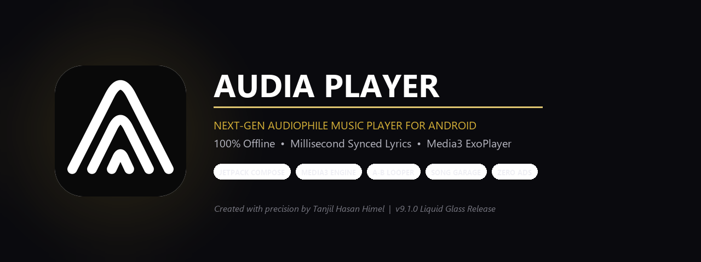
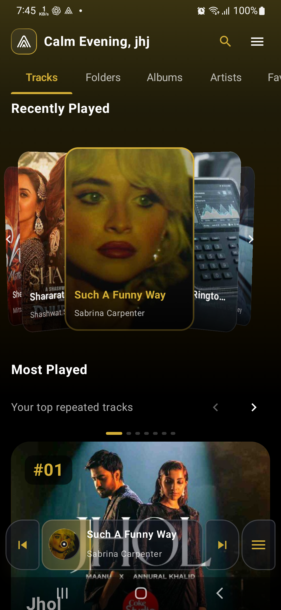
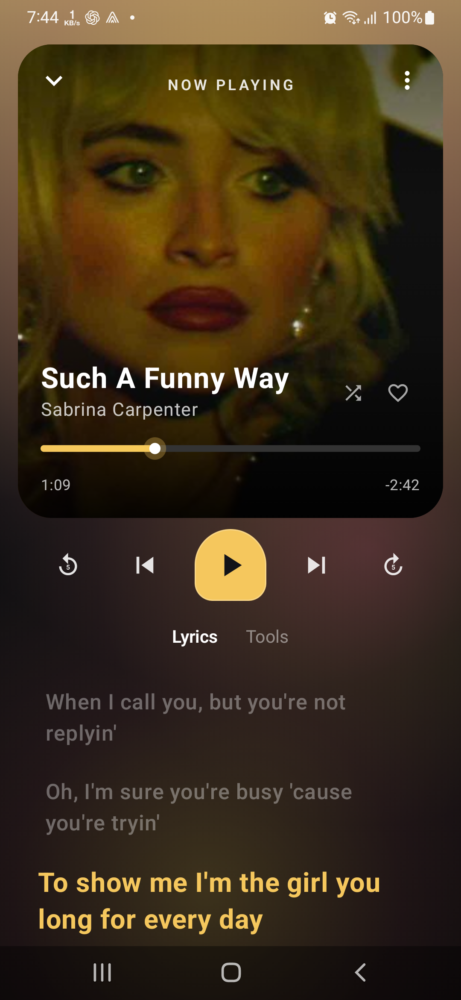
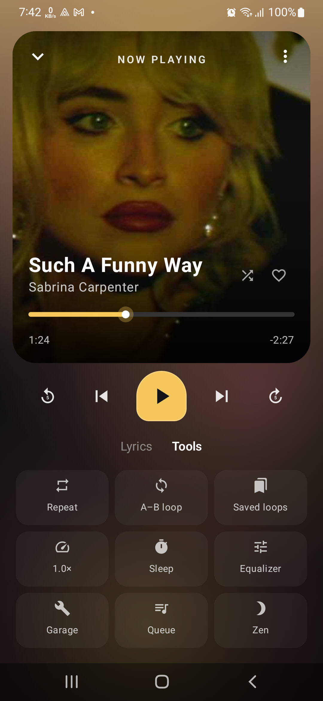
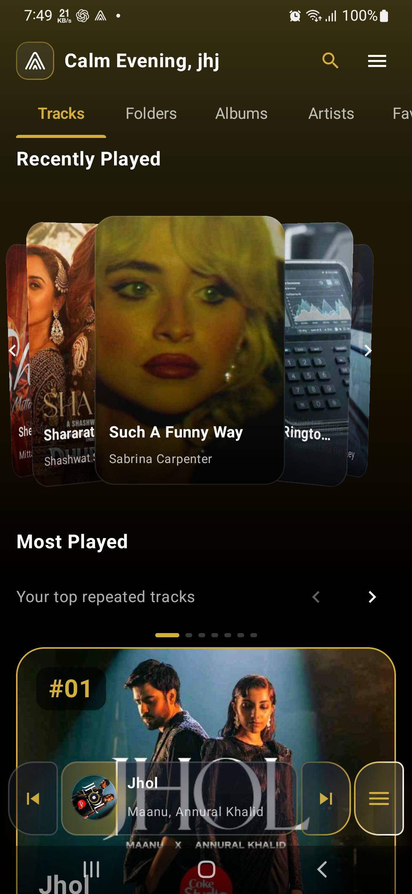

<p align="center">
  
</p>

<h1 align="center">🎵 Audia Player</h1>
<h3 align="center">Next-Gen Audiophile Offline Music Player & Floating Liquid Glass Experience for Android</h3>

<p align="center">
  <a href="https://github.com/TanjilHasan-Himel/app/releases/latest/download/Audia-latest.apk">
    
  </a>
  <a href="https://github.com/TanjilHasan-Himel/app/releases">
    
  </a>
</p>

<p align="center">
  
  
  
  
  
  
  
</p>

<p align="center">
  Crafted with precision by <strong><a href="https://tanjilhasanhimel.me/">Tanjil Hasan Himel</a></strong><br>
  🌐 <a href="https://tanjilhasanhimel.me/">Portfolio Website</a> &nbsp;|&nbsp; 💼 <a href="https://www.linkedin.com/in/tanjilhasanhimel/">LinkedIn Profile</a> &nbsp;|&nbsp; 🐙 <a href="https://github.com/TanjilHasan-Himel">GitHub</a>
</p>

---

> [!IMPORTANT]
> **Official Product Presentation & Release Distribution Hub**  
> This public repository serves exclusively as the official product presentation, release distribution hub, and community issue tracker for **Audia Player**. The underlying Android application is a **closed-source, proprietary product**. The source code is maintained privately and is not distributed here. See the [Legal Disclaimer & Terms of Use](LEGAL.md) for details.

---

## 🌟 Executive Overview & Architecture

**Audia Player** is an uncompromising, modern offline music player and audio workstation engineered from the ground up for Android 8.0 through Android 15+. Built natively with **Jetpack Compose 1.7+** and Google's **AndroidX Media3**, Audia merges audiophile-grade studio fidelity with a signature **4-Piece Floating Liquid Glass Island** user interface.

Unlike legacy music players bloated with subscriptions, intrusive full-screen ads, and cloud tracking, Audia is strictly **local-first, ad-free, and battery-optimized**.

```
┌────────────────────────────────────────────────────────────────────────┐
│                        AUDIA ARCHITECTURE CORE                         │
├────────────────────────┬───────────────────────┬───────────────────────┤
│    PRESENTATION (UI)   │     AUDIO ENGINE      │   LOCAL PERSISTENCE   │
│  Jetpack Compose 1.7+  │   AndroidX Media3     │      Room 2.8+        │
│  Material 3 + Blur     │   ExoPlayer Low-Jank  │      DataStore        │
│  4-Piece Floating Dock │   Biquad DSP Engine   │    SAF Local-First    │
└────────────────────────┴───────────────────────┴───────────────────────┘
```

---

## 🚀 The Architecture Evolution: Previous vs. New (Main Show)

Audia's signature design revolution: transitioning from a monolithic bottom deck into a decoupled, physics-driven **4-Piece Floating Liquid Glass Island**:

<div align="center">
  <table>
    <tr>
      <td align="center" width="50%">
        <strong>🕰️ PREVIOUS (Legacy Architecture - v9.0)</strong><br>
        <em>Monolithic Solid Bottom Bar &bull; Linear Seekbar &bull; Fixed Dock</em><br><br>
        
      </td>
      <td align="center" width="50%">
        <strong>✨ NEW (Modular Liquid Glass - v9.1) — MAIN SHOW ⭐️</strong><br>
        <em>4-Piece Floating Island &bull; In-Button Liquid Theme Fill &bull; Travelling Light Beam</em><br><br>
        
      </td>
    </tr>
  </table>
</div>

---

## 📱 Interface Showcase Gallery

<div align="center">
  <table>
    <tr>
      <td align="center" width="33%">
        <strong>📀 Home & Floating MiniPlayer</strong><br><br>
        
      </td>
      <td align="center" width="33%">
        <strong>🎨 Now Playing & Ambient Bloom</strong><br><br>
        
      </td>
      <td align="center" width="33%">
        <strong>📜 Real-Time Synced Lyrics</strong><br><br>
        
      </td>
    </tr>
    <tr>
      <td align="center" width="33%">
        <strong>🎛️ Equalizer & Biquad DSP Curve</strong><br><br>
        
      </td>
      <td align="center" width="33%">
        <strong>🏎️ Song Garage (Lossless Inspector)</strong><br><br>
        
      </td>
      <td align="center" width="33%">
        <strong>🌌 Zen Mode (Distraction-Free)</strong><br><br>
        
      </td>
    </tr>
  </table>
</div>

---

## ✨ Signature Innovations & Capabilities

### 1. 🪟 4-Piece Floating Liquid Glass Island
A radical departure from static bottom bars. Audia introduces an organically floating, decoupled 4-piece frosted glass island:
* **In-Button Liquid Progress:** Real-time theme-tinted gradient fill directly behind the play/pause glyph with glowing crest.
* **Unified Travelling Beam:** A single continuous light beam traversing all 4 pieces seamlessly with edge flares.
* **Haptic Tactility:** Subtle physical vibration cues on transport actions.

### 2. 🎼 Audiophile Playback Engine
* **Format Supremacy:** Bit-perfect native decoding for FLAC (up to 24-bit/192kHz), ALAC, WAV, OGG, Opus, AAC, and MP3.
* **5-Band Parametric Equalizer:** Real-time Biquad DSP frequency response curve, granular Bass Boost, and 3D Virtualizer.
* **Musician-Grade A-B Looper:** Create, name, and store multiple micro-loops per song for practice, transcription, or focused listening.

### 3. 📜 Millisecond-Accurate Synced Lyrics
* Powered by LRCLIB with instant offline local caching.
* Accurate line-by-line highlighting with dynamic smooth auto-scroll.
* Manual candidate selector and live synchronization offset adjuster.

### 4. 📻 Global Web Radio Workstation
* Integrated with the community-powered Radio-Browser database.
* Browse and stream thousands of worldwide stations across genres, countries, and broadcast languages.
* Dedicated independent radio queue preventing interruption to your local library playlist.

### 5. ⏰ Reliable Scheduled Playback Engine
* Wake up or drift off to your curated albums or playlists.
* Engineered with Android `AlarmManager` and `WorkManager` for guaranteed execution across deep-sleep and device reboots.

---

## ⚖️ Why Audia? (Feature Matrix vs Alternatives)

| Feature Dimension | Audia Player | Poweramp | Retro Music | Musicolet |
| :--- | :---: | :---: | :---: | :---: |
| **Pricing & Ads** | **100% Free / Zero Ads** | Paid (~$5.99) | Freemium | Free |
| **UI Paradigm** | **Modular Liquid Glass (Compose)** | Legacy Skinned Views | Material 2/3 | Standard Android |
| **Download Size** | **~4.7 MB (Ultra-Light)** | ~18 MB | ~15 MB | ~6 MB |
| **Audio Core** | **AndroidX Media3 ExoPlayer** | Custom Native Engine | MediaPlayer / Exo | Custom Decoders |
| **Per-Song A-B Looper** | **Yes (Named Presets)** | Basic A-B | ❌ No | Basic A-B |
| **Real-Time Synced Lyrics**| **Yes (LRCLIB Cached)** | Plugin Dependent | ❌ Basic | Local LRC only |
| **Global Internet Radio** | **Yes (Built-in)** | ❌ No | ❌ No | ❌ No |
| **Scheduled Playback** | **Yes (Persistent Alarm)** | Sleep Timer only | Sleep Timer only | Sleep Timer only |
| **Privacy & Telemetry** | **100% Local-First** | License Verification | Google Analytics | Local Only |

---

## 📥 Instant Download & Sideload Instructions

Audia is distributed as an officially signed, optimized Android Application Package (`.apk`).

### ⚡ Permanent Latest Download Link
Always fetches the most recent stable release directly:
👉 **[Download Audia Latest APK](https://github.com/TanjilHasan-Himel/app/releases/latest/download/Audia-latest.apk)**

### 📱 Step-by-Step Installation
1. Click the download button above or choose an explicit version from [GitHub Releases](https://github.com/TanjilHasan-Himel/app/releases).
2. Open the downloaded `.apk` file on your Android smartphone.
3. If prompted by Android, allow **Install unknown apps** permission for your browser or file manager.
4. Launch **Audia Player**, grant local audio storage access, and enjoy uncompromised music playback.

---

## 🛠️ Technical Specifications

| Parameter | Specification |
| :--- | :--- |
| **Operating System** | Android 8.0 (API 26) through Android 15 (API 35) |
| **Language & Architecture** | 100% Modern Kotlin, Coroutines, StateFlow, Dagger Hilt |
| **UI Framework** | Jetpack Compose 1.7+, Material 3, Dynamic Color Theming |
| **Audio Pipeline** | AndroidX Media3 1.11.1 ExoPlayer Core |
| **Persistence Layer** | Android Room Database 2.8+, Jetpack DataStore |
| **Binary Optimization** | ProGuard / R8 Obfuscation, Minification, Resource Shrinking (4.7 MB) |
| **Core Permissions** | `READ_MEDIA_AUDIO` (Android 13+), `FOREGROUND_SERVICE_MEDIA_PLAYBACK`, `POST_NOTIFICATIONS` |

---

## 📋 Changelog

### Version 9.1.2 (Current Stable - November 17, 2026)
- **Brand Identity Play Controls:** Restored the iconic Audia Triple Arch logo mark directly on the central Play/Pause controls in idle/paused state across Full Player, MiniPlayer, and Zen Mode.
- **Unified Production Signing:** Configured permanent production release keystore ensuring seamless, zero-conflict in-app updates without uninstallation.
- **Modernized Legal & Privacy Alignment:** Updated EULA and Privacy Policy with full disclosures of Android Auto, persistent M3U playlists, telemetry toggles, and automated updates.

### Version 9.1.1 (November 16, 2026)
- **Persistent Custom Playlists:** Create, rename, delete, and manage custom playlists persisted in Room DB with instant M3U / M3U8 export and import.
- **Android Auto Head Unit Integration:** Official AndroidX Media3 `MediaLibraryService` tree for safe, full car-display browsing and playback.
- **Automated In-App Update Engine:** Background 24-hour update checks with direct download and gentle reminder alerts.

### Version 9.1.0
- **Modular 4-Piece Liquid Glass MiniPlayer:** Completely redesigned miniplayer into four independent translucent glass components with organic spring physics.
- **Dynamic In-Button Liquid Progress Fill:** Replaced legacy bottom progress bars with an in-button theme-tinted gradient fill and glowing crest beam.
- **Unified Travelling Light Beam:** Single continuous shimmer beam calculating global distance across all 4 pieces with dynamic edge flare.
- **Floating Quick-Queue Frosted Card:** Tap the queue arc to inspect and launch upcoming tracks without losing your browsing position.
- **Equalizer & Biquad DSP Engine:** Added 5-band parametric equalizer with live frequency curve visualization, Bass Boost, and 3D Virtualizer.
- **Automated CI/CD Delivery Pipeline:** Fully automated GitHub Actions workflow with dynamic `Audia-v<version>.apk` and `Audia-latest.apk` packaging.

---

## 🗺️ Product Roadmap

- [x] Android 15 edge-to-edge UI & Media3 background playback
- [x] Modular 4-piece liquid glass floating miniplayer
- [x] LRCLIB millisecond synchronized lyrics with offline caching
- [x] Precision A-B Looper with named song-specific presets
- [x] 5-Band Biquad DSP Equalizer with visual curve response
- [x] Global Radio Browser streaming engine
- [x] Scheduled Playback Alarm Engine
- [x] Real Android Auto Head Unit integration
- [x] M3U / M3U8 Playlist import & export
- [ ] True Gapless Crossfade & ReplayGain loudness normalization
- [ ] Tag Studio with Storage Access Framework (SAF) in-file saving
- [ ] `.audia` portable single-file settings & queue backup

---

## ⚖️ Legal Disclaimer & Proprietary Notice

* **Proprietary Software Notice:** Audia Player (including its compiled APK, user interface designs, custom graphics, brand assets, and underlying code) is a **closed-source, proprietary application** owned exclusively by **Tanjil Hasan Himel**. All rights reserved.
* **Repository License Scope:** The [MIT License](LICENSE) in this repository applies strictly to the documentation, guides, and showcase assets hosted in this repository. It **does NOT apply** to the application binary or source code.
* **Content Disclaimer:** Audia Player is an offline audio visualizer and playback tool. It does not host, stream, or distribute copyrighted music. Users are solely responsible for audio files stored on their devices.
* See [LEGAL.md](LEGAL.md) for full legal disclosures and terms.

---

<p align="center">
  Crafted with precision by <strong><a href="https://tanjilhasanhimel.me/">Tanjil Hasan Himel</a></strong><br>
  <em>Personal Website: <a href="https://tanjilhasanhimel.me/">tanjilhasanhimel.me</a> &bull; LinkedIn: <a href="https://www.linkedin.com/in/tanjilhasanhimel/">linkedin.com/in/tanjilhasanhimel</a></em>
</p>
