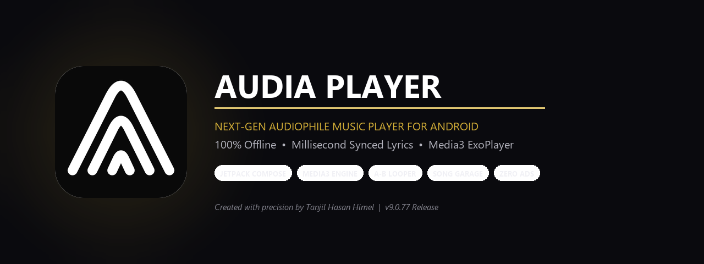
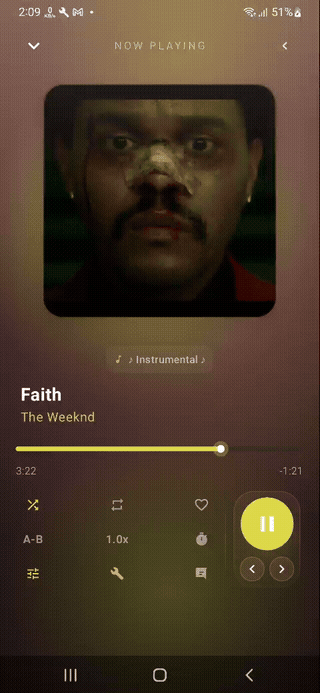
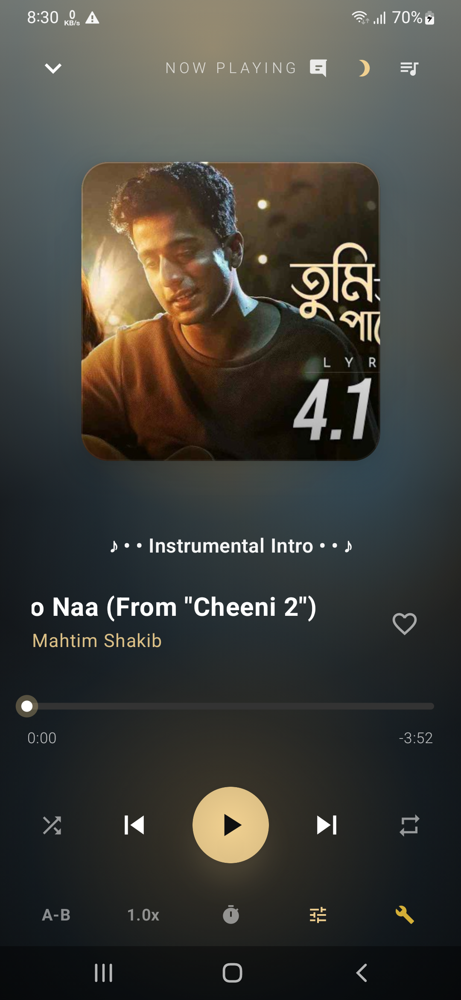
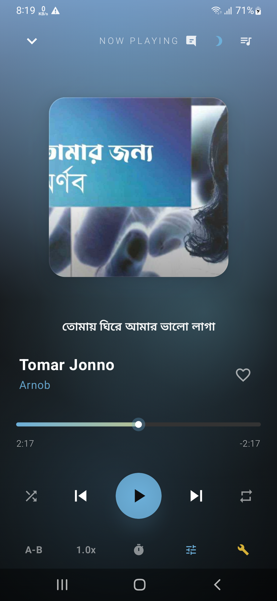
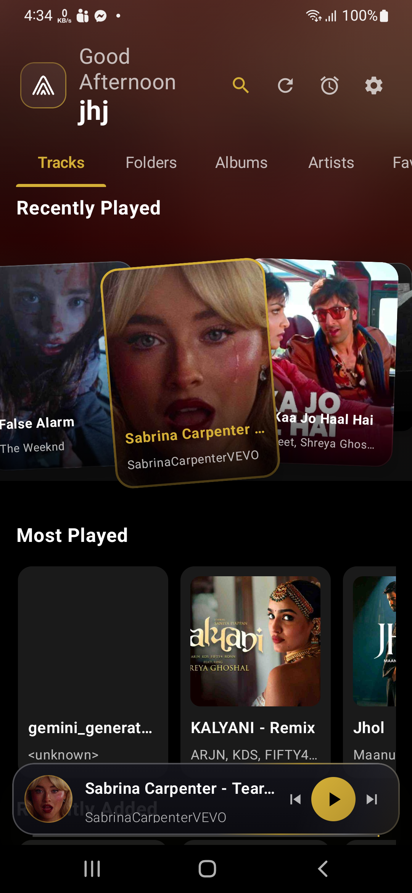
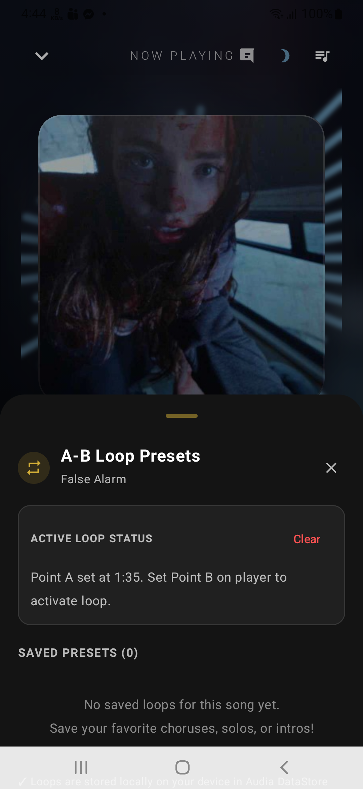
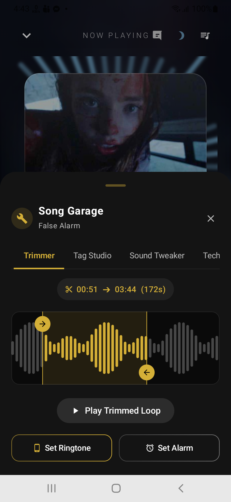
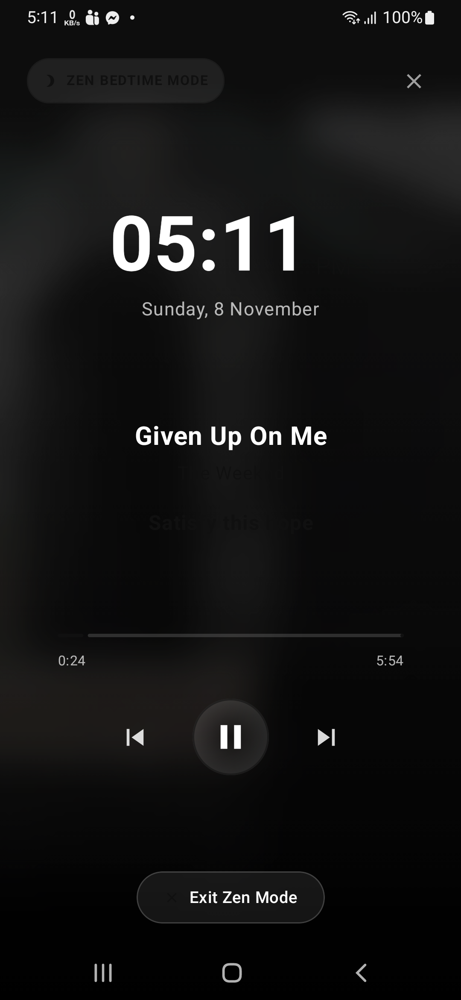
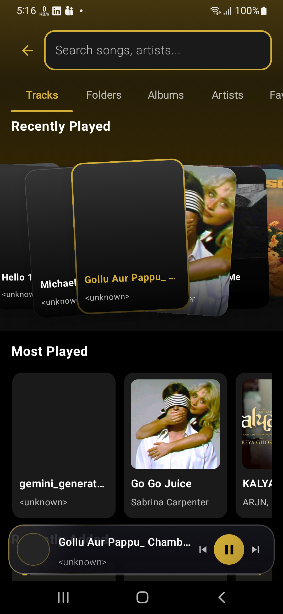

  

  
  
  
  
  
  
  
  

  Crafted with precision by <strong><a href="https://tanjilhasanhimel.me/">Tanjil Hasan Himel</a></strong> 
  🌐 <a href="https://tanjilhasanhimel.me/">Portfolio Website</a> &nbsp;|&nbsp; 💼 <a href="https://www.linkedin.com/in/tanjilhasanhimel/">LinkedIn Profile</a>

---

> [!IMPORTANT]
> **Product Showcase & Official Release Hub**  
> This public repository serves exclusively as the official product presentation, release distribution hub, and issue tracker for **Audia Player**. The underlying Android application is a **closed-source, proprietary product**. The source code is maintained in a private repository and is not distributed here.

---

  

---

## 🌟 Overview

**Audia Player** (formerly *PlayTime*) is a next-generation, high-performance offline music player built for modern Android devices. Designed from the ground up with **Jetpack Compose 1.7+** and **AndroidX Media3**, Audia merges glassmorphic aesthetics, sound-reactive ambient bloom, and an audiophile-grade playback engine without advertisements, telemetry, or battery drain.

Whether you're listening to high-resolution FLAC audio, following along with millisecond-accurate synchronized lyrics, looping complex solos with the precision A-B looper, or inspecting acoustic metadata in the Song Garage, Audia is crafted for true audio enthusiasts.

---

## 🎬 Live Demo & Visual Showcase

  <table>
    <tr>
      <td align="center" width="50%">
        <strong>📱 Interactive Live Demo</strong>  
        
      </td>
      <td align="center" width="50%">
        <strong>🎨 Now Playing & Stage</strong>  
        
      </td>
    </tr>
  </table>

  <table>
    <tr>
      <td align="center" width="33%">
        <strong>📜 Real-Time Synced Lyrics</strong>  
        
      </td>
      <td align="center" width="33%">
        <strong>📀 Home & Turntable Feed</strong>  
        
      </td>
      <td align="center" width="33%">
        <strong>🔁 Precision A-B Looper</strong>  
        
      </td>
    </tr>
    <tr>
      <td align="center" width="33%">
        <strong>🛠️ Song Garage & Inspector</strong>  
        
      </td>
      <td align="center" width="33%">
        <strong>🌙 Zen Bedtime Mode</strong>  
        
      </td>
      <td align="center" width="33%">
        <strong>🔍 Instant Library Search</strong>  
        
      </td>
    </tr>
  </table>

---

## ✨ Key Features & Capabilities

### 🎨 Adaptive Fluid Stage & Reactive Bloom
- **Dynamic Ambient Bloom:** Extracts dominant and secondary vibrant hues from album artwork using Palette analysis to generate a rich, breathing background glow.
- **Custom Arch Morph Button:** Iconic signature Arch Play/Pause button that smoothly morphs into a circular geometry during playback.
- **Real-Time FFT Visualizer:** Audio-reactive ambient lighting tuned to bass frequencies and sound energy.
- **Responsive Multi-Screen Architecture:** Fluidly scales across compact screens (16:9, 18:9), modern tall ratios, foldable devices, and 3-button navigation layouts.

### 📜 Real-Time Synced Lyrics (LRCLIB Engine)
- **Millisecond Precision:** Instant karaoke-style synchronized lyrics powered by the LRCLIB network API.
- **Stable 48dp Slot:** Strictly deterministic preview slot height prevents track titles, progress bars, and playback buttons from jumping.
- **Full-Screen Stage:** Tap any preview lyric to enter edge-to-edge immersive lyrics mode with automatic auto-scroll and manual seek navigation.
- **Offline Storage:** Downloaded lyrics are cached in a local database for instant offline access.

### 🔁 Musician-Grade A-B Looper & Presets
- **Precision Looping:** Set millisecond-accurate start (A) and end (B) loop points on any track.
- **Permanent Named Presets:** Save and name custom loops (guitar riffs, vocal phrases, dance practice routines) to local storage.

### 🛠️ Song Garage & Audio Inspector
- **Lossless Quality Detection:** Automatic detection and visual badging for FLAC, Hi-Res 24-bit/96kHz, WAV, AAC, and MP3.
- **Technical Specs Inspector:** Real-time visibility into bitrate, sample rate, bit depth, channel configuration, and container details.
- **Built-in Audio Trimmer & Tag Editor:** Edit track metadata and extract custom audio clips on-device.

### 🎚️ Sound Processing & Effects
- **10-Band Graphic Equalizer** with genre presets and user curve saving.
- **Acoustic Enhancements:** Bass Boost, Virtualizer, and Loudness Enhancer for headphones and speakers.

### 🌙 Zen Bedtime Mode & Smart Sleep Timer
- **Zen Ambient Screen:** Distraction-free night listening mode with dim visualizer.
- **Smart Sleep Timer:** Gentle volume fade-out with optional "Stop playback after current song" toggle.

### 🔒 100% Offline-First & Privacy Centric
- **Zero Tracking:** No analytics libraries, crash-reporting SDKs, or background telemetry.
- **Zero Ads:** Completely ad-free interface.
- **Ultra Lightweight:** Optimized release build at just **3.25 MB**.

---

## 🛠️ Technical Overview

| Category | Technology |
| :--- | :--- |
| **Language** | Kotlin 2.0+ |
| **UI Framework** | Jetpack Compose 1.7+, Material 3, Custom Canvas Drawing |
| **Audio Engine** | AndroidX Media3 (`ExoPlayer`, `MediaSessionService`, `MediaBrowserService`) |
| **Architecture** | MVI / MVVM + Clean Architecture with Kotlin Coroutines & `StateFlow` |
| **Dependency Injection** | Dagger Hilt |
| **Local Persistence** | Room Database (Lyrics, Loop Presets, Song Wiki) + DataStore Preferences |
| **Image Loading** | Coil 2.6+ with dynamic Palette extraction |
| **System Compatibility** | Android 8.0 (API 26) through Android 15 (API 35) |

---

## 📥 Download & Installation

Audia is distributed as an optimized, signed Android Application Package (`.apk`).

1. Download the latest release from the [GitHub Releases](https://github.com/TanjilHasan-Himel/app/releases) section.
2. Open the downloaded `.apk` file on your Android device.
3. If prompted, allow installation from unknown sources for your browser or file manager.
4. Launch **Audia Player** and grant storage permission to index your local audio library.

> [!NOTE]
> Audia requires no account registration, logins, or cloud synchronization. Your entire music library and metadata stay strictly on your device.

---

## 📋 Changelog (v9.0.77)

- **Complete Rebranding:** Transformed from *PlayTime* into **Audia Player**.
- **Responsive Layout Engine:** Resolved layout clipping and dead vertical space across compact and tall aspect ratio devices.
- **System Media Controls:** Added full support for Android 11 & 12 lock screen media controls and notification Quick Settings.
- **LRCLIB Synced Lyrics:** Integrated millisecond-accurate synchronized lyrics with offline caching and stable 48dp preview stage.
- **Sound-Reactive Ambient Glow:** Introduced FFT frequency-reactive lighting behind album art.
- **A-B Loop Presets:** Implemented persistent storage and naming for custom loop sections.
- **Song Garage:** Added comprehensive audio specs inspector and lossless quality detection.

---

## 🗺️ Product Roadmap

- [x] Full Android 14/15 edge-to-edge support & Media3 lock screen controls
- [x] Real-time synced lyrics with offline caching
- [x] Precision A-B Looper with named presets
- [ ] Global FM & Web Radio integration (Radio-Browser API)
- [ ] Online music search and streaming integration
- [ ] Android Auto playback support
- [ ] Desktop companion app (Compose Multiplatform)

---

## 💬 Community & Feedback

Found a bug or have an idea for a new feature?
- Submit a detailed report via [GitHub Issues](https://github.com/TanjilHasan-Himel/app/issues).
- Start a conversation in [GitHub Discussions](https://github.com/TanjilHasan-Himel/app/discussions).

---

## 📄 License & Terms

- **Repository License:** The documentation, screenshots, and presentation assets in this repository are licensed under the **[MIT License](LICENSE)**.
- **Application License:** The **Audia Player** Android application and binary are proprietary freeware (Closed Source). All rights reserved.

> [!NOTE]
> The MIT License applies exclusively to the showcase assets and documentation in this repository. It does not grant rights to the underlying application source code or trademark.

---

  Crafted with precision by <strong><a href="https://tanjilhasanhimel.me/">Tanjil Hasan Himel</a></strong> 
  <em>Personal Website: <a href="https://tanjilhasanhimel.me/">tanjilhasanhimel.me</a> &bull; LinkedIn: <a href="https://www.linkedin.com/in/tanjilhasanhimel/">linkedin.com/in/tanjilhasanhimel</a></em>

