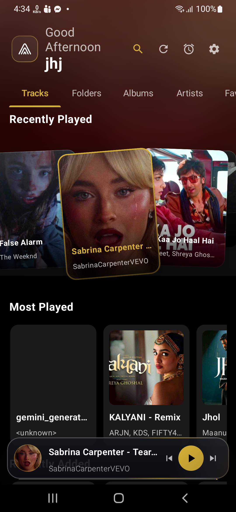
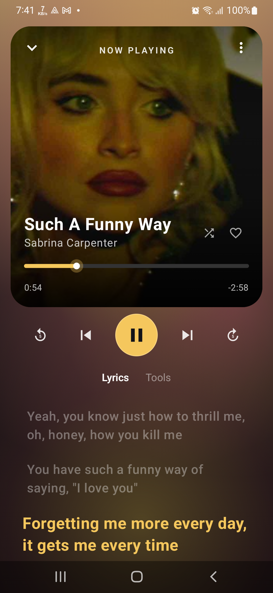
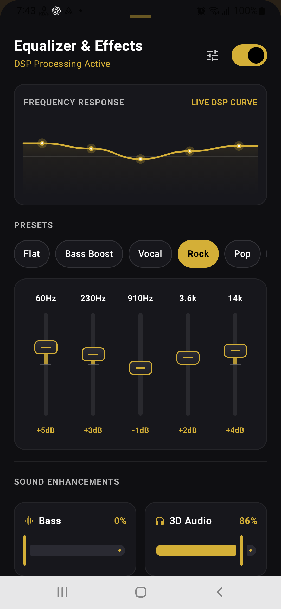
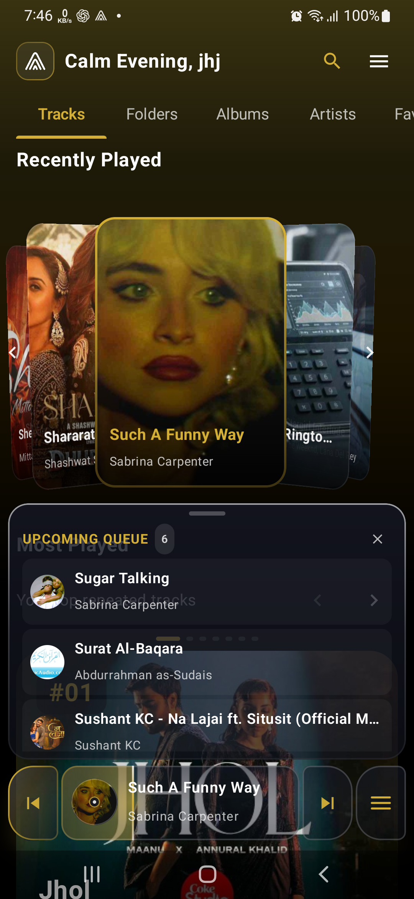

  

  
  
  
  
  
  
  
  

  Crafted with precision by <strong><a href="https://tanjilhasanhimel.me/">Tanjil Hasan Himel</a></strong> 
  🌐 <a href="https://tanjilhasanhimel.me/">Portfolio Website</a> &nbsp;|&nbsp; 💼 <a href="https://www.linkedin.com/in/tanjilhasanhimel/">LinkedIn Profile</a>

---

> [!IMPORTANT]
> **Product Showcase & Official Release Hub**  
> This public repository serves exclusively as the official product presentation, release distribution hub, and issue tracker for **Audia Player**. The underlying Android application is a **closed-source, proprietary product**. The source code is maintained in a private repository and is not distributed here. See the [Legal Disclaimer & Terms of Use](LEGAL.md) for details.

---

  

---

## 🌟 Overview

**Audia Player** is a next-generation, high-performance offline music player and audio workstation engineered for modern Android devices. Built entirely from the ground up using **Jetpack Compose 1.7+** and **AndroidX Media3**, Audia combines glassmorphic aesthetics, sound-reactive ambient bloom, and an audiophile-grade playback engine — with **zero advertisements, zero background trackers, and zero telemetry**.

From high-resolution 24-bit/192kHz FLAC playback to millisecond-synchronized lyrics, musician-grade A-B looping, real-time Biquad DSP equalization, global internet radio streaming, and a signature **modular 4-piece floating liquid glass mini-player**, Audia is purpose-built for listeners who demand uncompromised fidelity and craftsmanship.

---

## 🚀 The Architecture Evolution: Previous vs. New (Main Show)

Audia's signature design revolution: transitioning from a monolithic bottom deck into a decoupled, physics-driven **4-Piece Floating Liquid Glass Island**:

  <table>
    <tr>
      <td align="center" width="50%">
        <strong>🕰️ PREVIOUS (Legacy Architecture - v9.0)</strong> 
        <em>Monolithic Solid Bottom Bar &bull; Linear Seekbar &bull; Fixed Dock</em>  
        
      </td>
      <td align="center" width="50%">
        <strong>✨ NEW (Modular Liquid Glass - v9.1) — MAIN SHOW ⭐️</strong> 
        <em>4-Piece Floating Island &bull; In-Button Liquid Theme Fill &bull; Travelling Light Beam</em>  
        
      </td>
    </tr>
  </table>

---

## 📱 Complete Interface Showcase

  <table>
    <tr>
      <td align="center" width="25%">
        <strong>📀 Home & Liquid MiniPlayer</strong>  
        
      </td>
      <td align="center" width="25%">
        <strong>🎨 Now Playing & Bloom Stage</strong>  
        
      </td>
      <td align="center" width="25%">
        <strong>📜 Real-Time Synced Lyrics</strong>  
        
      </td>
      <td align="center" width="25%">
        <strong>🎛️ Equalizer & Biquad DSP Curve</strong>  
        
      </td>
    </tr>
    <tr>
      <td align="center" width="25%">
        <strong>🛠️ Musician Tools & Audio Inspector</strong>  
        
      </td>
      <td align="center" width="25%">
        <strong>📋 Floating Frosted Quick-Queue</strong>  
        
      </td>
      <td align="center" width="25%">
        <strong>🔍 Instant Library Search & Filter</strong>  
        
      </td>
      <td align="center" width="25%">
        <strong>🌙 Minimal Zen Bedtime Mode</strong>  
        
      </td>
    </tr>
  </table>

---

## 🏆 Why Audia? (Feature Comparison)

| Dimension | Audia Player 🎵 | Standard Offline Players 📻 | Cloud Streaming Apps ☁️ |
| :--- | :---: | :---: | :---: |
| **Privacy & Telemetry** | **100% Offline (Zero Tracking)** | Offline only | Cloud Tracking & User Profiling |
| **Advertisements** | **Zero Ads Forever** | Banner Ads / Interstitials | Audio Ads / Paid Subscriptions |
| **MiniPlayer Architecture** | **Modular 4-Piece Floating Liquid Glass** | Static single bottom bar | Generic anchored bar |
| **In-Button Progress Fill** | **Fluid Theme-Reactive Gradient Fill** | Basic horizontal line | Basic seekbar |
| **Light Dynamics** | **Unified Continuous Travelling Shimmer** | None | None |
| **Quick-Queue Access** | **Floating Frosted Card Overlay** | Full screen switch | Full screen switch |
| **Synced Lyrics** | **Millisecond Accurate (LRCLIB)** | None or manual `.lrc` | Paywalled / Network Bound |
| **Musician A-B Looper** | **Built-in with Named Presets** | Rare / None | Unavailable |
| **Audio Processing** | **Biquad DSP + 5-Band Parametric EQ** | Generic Android Equalizer | Fixed audio processing |
| **Global Radio** | **Integrated Free Radio-Browser** | Requires separate app | Geoblocked / Subscription |
| **Memory Footprint** | **Ultra-Lightweight (~3.3 MB APK)** | 25 MB – 80 MB | 120 MB+ |
| **System Compatibility** | **Android 8.0 – 15 Media3 Session** | Partial or Glitchy | Standard |

---

## ✨ Key Features & Architectural Innovations

### 💎 Modular 4-Piece Floating Liquid Glass MiniPlayer
Audia introduces an industry-first decoupled miniplayer architecture built with custom Compose canvas graphics, translucent frosted sapphire glass, and organic physics:
- **Modular 4-Piece Separation:** The miniplayer is split into four distinct interactive units:
  1. **Left Arc `(|`:** Skip previous track with spring bounce physics.
  2. **Center Deck:** Rotating vinyl artwork, song metadata, vertical swipe-to-open gesture, and tap-to-toggle playback.
  3. **Right Arc `|)`:** Skip next track with symmetrical inverse curve.
  4. **Queue Arc `(|`:** Dedicated quick-queue button with gold hamburger badge.
- **Dynamic In-Button Liquid Theme Progress Fill:** Legacy bottom line progress bars have been replaced with an organic in-button progress fill. As the song plays, a theme-tinted translucent gradient fills the entire body of the center deck from left to right, guided by a vertical glowing crest beam and ambient halo.
- **Unified Continuous Travelling Light Beam:** A single physical light shimmer beam sweeps continuously across all 4 independent pieces, dynamically calculating global horizontal distance. When the beam passes over each piece, its translucent border and drop-shadow glow flare up in real time.
- **True Floating Island Overlay:** Floats above scrollable lists with 40–60% translucent dark sapphire glass, allowing song cards and album artwork to glide visibly underneath.
- **Floating Quick-Queue Card:** Tapping the queue arc reveals a frosted glass overlay directly above the miniplayer, displaying the next upcoming tracks with instant tap-to-play and a fluid swipe-down dismiss gesture.

### 🎨 Adaptive Fluid Stage & Reactive Bloom
- **Dynamic Ambient Bloom:** Extracts dominant and vibrant hues from album artwork using Palette analysis to generate a rich, breathing background glow.
- **Real-Time FFT Visualizer:** Audio-reactive ambient lighting tuned to bass frequencies and sound energy.
- **Responsive Multi-Screen Architecture:** Fluidly scales across compact screens (16:9, 18:9), modern tall ratios, foldable devices, and 3-button navigation layouts.

### 📜 Real-Time Synced Lyrics (LRCLIB Engine)
- **Millisecond Precision:** Instant karaoke-style synchronized lyrics powered by the LRCLIB network API.
- **Stable 48dp Slot:** Strictly deterministic preview slot height prevents track titles, progress bars, and playback buttons from jumping.
- **Full-Screen Stage:** Tap any preview lyric to enter edge-to-edge immersive lyrics mode with automatic auto-scroll and manual seek navigation.
- **Offline Storage:** Downloaded lyrics are cached in a local Room database for instant offline access.

### 🎛️ Biquad DSP Equalizer & Acoustic Architecture
- **5-Band Parametric Equalizer:** Precise frequency shaping across low, mid, and high frequencies.
- **Real-Time DSP Response Curve:** Visualizes the acoustic response curve live as you adjust frequency bands.
- **Bass Boost & 3D Spatial Virtualizer:** Hardware-accelerated audio effects tuned for both wired studio monitors and wireless Bluetooth headphones.

### 📻 Global Internet Radio Engine
- **Radio-Browser Directory:** Stream thousands of free, public radio stations across every genre and country worldwide.
- **Low-Latency Streaming:** Native Media3 ExoPlayer stream buffering with instant metadata display.

### 🔁 Musician-Grade A-B Looper & Presets
- **Precision Looping:** Set millisecond-accurate start (A) and end (B) loop points on any track.
- **Permanent Named Presets:** Save and name custom loops (guitar solos, vocal phrases, choreography routines) to local storage.

### 🛠️ Song Garage & Audio Inspector
- **Lossless Quality Detection:** Automatic detection and visual badging for FLAC, Hi-Res 24-bit/96kHz, WAV, AAC, and MP3.
- **Technical Specs Inspector:** Real-time visibility into bitrate, sample rate, bit depth, channel configuration, and container details.
- **Built-in Tag Editor:** Edit track metadata directly on-device.

### 🌙 Zen Bedtime Mode & Smart Sleep Timer
- **Zen Ambient Screen:** Minimalist, distraction-free night listening mode with dim visualizer.
- **Smart Sleep Timer:** Gentle volume fade-out with optional "Stop playback after current song" toggle.

---

## 🎧 Supported Audiophile Audio Formats

Audia utilizes native 32-bit floating point audio decoding via AndroidX Media3:

- **Lossless Hi-Res Audio:** `FLAC` (up to 24-bit / 192 kHz), `ALAC`, `WAV`, `AIFF`
- **Compressed & Lossy:** `MP3` (up to 320 kbps CBR/VBR), `AAC` (`.m4a`), `OGG Vorbis`, `OPUS`
- **Multi-channel & High Bitrate:** Native gapless playback with dynamic replay gain calculation.

---

## 🕹️ Gestures & Interaction Shortcuts

| Action | Gesture | Description |
| :--- | :--- | :--- |
| **Open Full Player** | **Swipe Up MiniPlayer** | Swipe up on the center deck to open the full now-playing stage |
| **Toggle Quick-Queue** | **Tap Queue Arc `(|`** | Opens floating frosted quick-queue overlay directly above miniplayer |
| **Dismiss Quick-Queue** | **Swipe Down Overlay** | Drag downward on the quick-queue card or tap close button |
| **Seek ±5s** | **Double-Tap Margin** | Double-tap left margin for `-5s`, right margin for `+5s` with floating ripple badge |
| **Continuous Seek** | **Rapid Taps** | Rapid subsequent taps accumulate seek (`±10s`, `±15s`, `±20s`) |
| **Toggle Lyrics Mode** | **Tap Lyrics / Art** | Single tap on the lyric line or artwork opens full-screen lyrics mode |
| **Custom Artwork** | **Long-Press Artwork** | Opens gallery image picker to set custom high-res album cover |
| **Loop Presets** | **Long-Press A-B** | Opens bottom sheet displaying all saved loop sections with 1-tap playback |
| **Song Details** | **Tap Title / Artist** | Opens Song Wiki modal with artist biography and song metadata |
| **Zen Bedtime Mode** | **Tap Header Moon (🌙)** | Activates minimal night mode with dimmed display |

---

## 🛠️ Technical Overview

| Category | Technology |
| :--- | :--- |
| **Language** | Kotlin 2.0+ |
| **UI Framework** | Jetpack Compose 1.7+, Material 3, Custom Canvas Drawing & Shaders |
| **Audio Engine** | AndroidX Media3 (`ExoPlayer`, `MediaSessionService`, `MediaBrowserService`) |
| **DSP Processing** | Biquad Audio Filter Matrix + Android AudioEffect APIs |
| **Architecture** | MVI / MVVM + Clean Architecture with Kotlin Coroutines & `StateFlow` |
| **Dependency Injection** | Dagger Hilt |
| **Local Persistence** | Room Database (Lyrics, Loop Presets, Song Wiki, Schedules) + DataStore |
| **Image Loading** | Coil 2.6+ with dynamic Palette extraction |
| **Radio Service** | Radio-Browser Network API with resilient failover |
| **System Compatibility** | Android 8.0 (API 26) through Android 15 (API 35) |

---

## 📥 Download & Installation

Audia is distributed as an optimized, signed Android Application Package (`.apk`).

1. Download the latest release from the [GitHub Releases](https://github.com/TanjilHasan-Himel/app/releases) section.
2. Open the downloaded `.apk` file on your Android device.
3. If prompted, allow installation from unknown sources for your browser or file manager.
4. Launch **Audia Player** and grant storage permission to index your local audio library.

> [!NOTE]
> Audia requires no account registration, logins, or cloud synchronization. Your entire music library and metadata stay strictly on your device.

---

## 📋 Changelog

### Version 9.1.0 (Current)
- **Modular 4-Piece Liquid Glass MiniPlayer:** Completely redesigned miniplayer into four independent translucent glass components with organic spring physics.
- **Dynamic In-Button Liquid Progress Fill:** Replaced legacy bottom progress bars with an in-button theme-tinted gradient fill and glowing crest beam.
- **Unified Travelling Light Beam:** Single continuous shimmer beam calculating global distance across all 4 pieces with dynamic edge flare.
- **Floating Quick-Queue Frosted Card:** Tap the queue arc to inspect and launch upcoming tracks without losing your browsing position; includes drag-down dismiss gesture.
- **Equalizer & Biquad DSP Engine:** Added 5-band parametric equalizer with live frequency curve visualization, Bass Boost, and 3D Virtualizer.
- **Global Internet Radio:** Integrated Radio-Browser directory for live streaming thousands of worldwide stations.
- **Scheduled Playback Engine:** Added scheduled playback alarm triggers with boot-reschedule worker support.
- **Floating Island Navigation:** Miniplayer floats above scrollable song feeds with transparent frosted glass backdrop.

### Version 9.0.77
- **Complete Rebranding:** Transformed from *PlayTime* into **Audia Player**.
- **Responsive Layout Engine:** Resolved layout clipping and dead vertical space across compact and tall aspect ratio devices.
- **System Media Controls:** Added full support for Android 11 & 12 lock screen media controls and notification Quick Settings.
- **LRCLIB Synced Lyrics:** Integrated millisecond-accurate synchronized lyrics with offline caching and stable 48dp preview stage.
- **Sound-Reactive Ambient Glow:** Introduced FFT frequency-reactive lighting behind album art.
- **A-B Loop Presets:** Implemented persistent storage and naming for custom loop sections.
- **Song Garage:** Added comprehensive audio specs inspector and lossless quality detection.

---

## 🗺️ Product Roadmap

- [x] Full Android 14/15 edge-to-edge support & Media3 lock screen controls
- [x] Real-time synced lyrics with offline caching (LRCLIB)
- [x] Precision A-B Looper with named presets
- [x] Modular 4-piece liquid glass miniplayer with travelling light beam
- [x] High-precision Biquad DSP Equalizer with live response curve
- [x] Global Web Radio integration (Radio-Browser API)
- [ ] Online music search and streaming integration
- [ ] Android Auto playback support
- [ ] Desktop companion app (Compose Multiplatform)

---

## ⚖️ Legal Disclaimer & Terms of Use

Please read the complete [Legal Disclaimer & Terms of Use (LEGAL.md)](LEGAL.md) before installing or using Audia Player.

- **Proprietary Software Notice:** Audia Player (including its compiled APK, user interface designs, custom graphics, brand assets, and underlying code) is a **closed-source, proprietary application** owned exclusively by **Tanjil Hasan Himel**. All rights reserved.
- **Repository License Scope:** The [MIT License](LICENSE) in this repository applies strictly to the documentation, guides, and showcase assets hosted in this repository. It **does NOT apply** to the application binary or source code.
- **Content Disclaimer:** Audia Player is an offline audio visualizer and playback tool. It does not host, stream, or distribute copyrighted music. Users are solely responsible for audio files stored on their devices.
- **Third-Party Trademarks:** All artist names, album titles, and album covers shown in screenshots are property of their respective copyright holders and used solely for illustrative purposes.

---

## 💬 Community & Feedback

Found a bug or have an idea for a new feature?
- Submit a detailed report via [GitHub Issues](https://github.com/TanjilHasan-Himel/app/issues).
- Start a conversation in [GitHub Discussions](https://github.com/TanjilHasan-Himel/app/discussions).

---

  Crafted with precision by <strong><a href="https://tanjilhasanhimel.me/">Tanjil Hasan Himel</a></strong> 
  <em>Personal Website: <a href="https://tanjilhasanhimel.me/">tanjilhasanhimel.me</a> &bull; LinkedIn: <a href="https://www.linkedin.com/in/tanjilhasanhimel/">linkedin.com/in/tanjilhasanhimel</a></em>

